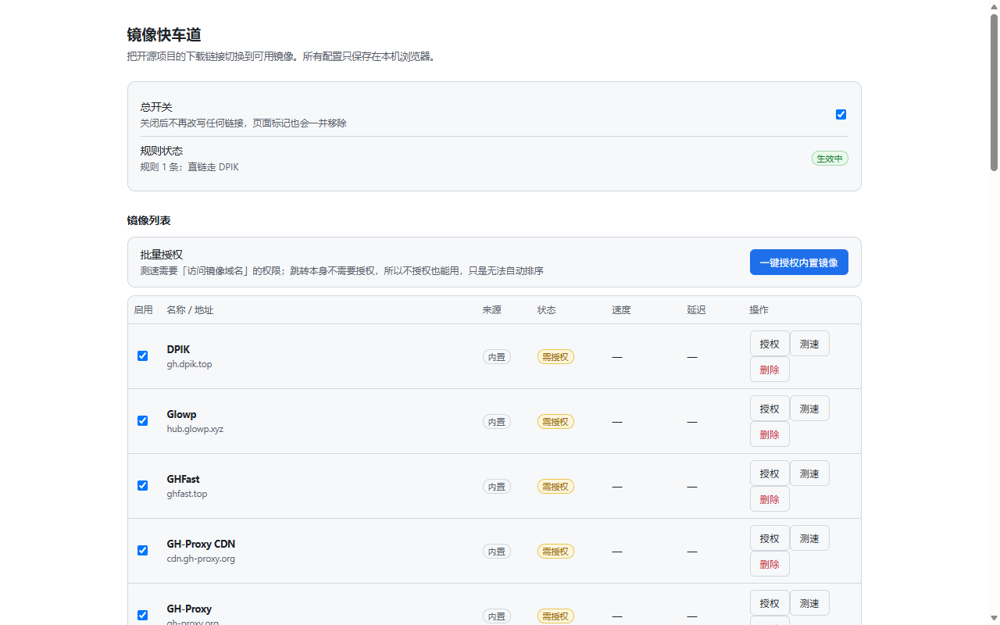

# 镜像快车道

GitHub 下载慢、动不动断线的时候，让下载链接自动走可用的镜像。

支持 Microsoft Edge / Google Chrome / Mozilla Firefox。零遥测，不收集任何数据，不需要注册。



## 装好之后

- 在 GitHub 点「下载」，请求会在网络层自动换到当时最快的可用镜像 —— 不经过代理，不改变你的出口 IP。
- 下载链接旁边多一个「镜像」角标，点一下就知道这次走了哪个镜像。
- 镜像挂了会自己换：真实下载中断、raw 请求失败率过高都会触发重新测速。
- 可以设生效时段（比如只在 20:00–02:00 用），时段外完全不改写，全部走主站。
- 可选哈希校验：下载完自动比对官方 SHA-256，对不上会弹通知。

## 它不是什么

- **不是 VPN**，不代理网页浏览，也不改变你的网络出口。
- **不缓存内容**，不往任何服务器上传数据。
- **管不到扩展之外**：把 GitHub 链接直接粘进 IDM、aria2 这类下载器，不会被改写（哈希校验可以覆盖这种场景）。

## 安装

如果你在 Edge Add-ons 或 Firefox AMO 里能搜到「镜像快车道」，直接装商店版最省事（会自动更新）。

搜不到就用手动方式，任选其一。手动装的不会自动升级，出新版本需要重新下载、替换目录。

**用打好的包（最简单）**

1. 到 [Releases](https://github.com/morangsu/mirror-fastlane/releases) 下载对应的 zip：
   - Chromium 系（Edge / Chrome）→ `mirror-fastlane-edge-<版本>.zip`
   - Firefox → `mirror-fastlane-firefox-<版本>.zip`
2. 解压到任意固定目录（别解压到临时目录，删了扩展就没了）。
3. 加载：
   - Edge：`edge://extensions` → 打开「开发人员模式」→「加载解压缩的扩展」→ 选解压出来的目录
   - Chrome：`chrome://extensions` → 打开「开发者模式」→「加载已解压的扩展程序」→ 同上
   - Firefox：`about:debugging#/runtime/this-firefox` →「临时载入附加组件」→ 选该目录里的 `manifest.json`

**从源码构建**

```bash
node build.mjs   # 产出 dist/edge、dist/firefox
```

然后按上面的方式加载 `dist/edge` 或 `dist/firefox`。仓库根目录是构建模板，不能直接加载。

> Firefox 的「临时载入」重启后会消失，这是浏览器对未签名临时扩展的限制（不是本扩展特有）。要长期使用，请装商店版，或使用签名过的 xpi。

## 第一次使用

1. **装完就能用。** 内置镜像已经配好，不需要授权任何东西，下载就会走镜像。
2. **想按速度挑镜像，点一次「一键授权内置镜像」。** 授权只影响测速排序，不影响改写本身；不授权也能正常下载，只是没法比较快慢。
3. **想要哈希校验，再看 [哈希校验说明](docs/hash-verify.md)。** 默认关闭，属于额外增强，配起来比前两步麻烦。

## 常见问题

**不授权镜像域名，功能会打折吗？**
跳转本身不需要镜像域名的权限（Firefox 与 Chromium 实测一致），但不授权是有代价的：

- **固定使用清单里排第一的镜像**，不按你的网络挑。它当时不可用，这次下载就失败。
- 同一个镜像**连续失败 3 次**才会被判不可用、换下一个（每次失败后 10 分钟内不重复计数）。也就是说最坏情况要连着失败三次才会自愈。
- 源码包与 raw 的失败率统计也都没有。

所以建议点一次「一键授权内置镜像」再测一次速：这一步不改变「能不能用」，改变的是「一次就挑到对你快的那个」。

零授权的实测数据：全新安装后规则照常生成一条，`github.com/…/releases/download/…` 命中并被改写到内置清单里排第一的镜像。

**源码包和 raw 文件也会走镜像吗？**
默认都不会。`codeload.github.com` 源码包和 `raw.githubusercontent.com` 单文件各有独立开关，要在设置页「改写行为」里勾选才生效；raw 勾选时还要过一次授权（它的请求地址属于可选权限）。直链下载不受这两个开关影响。

**为什么有时候还是慢？**
镜像质量波动很大，而且分流不等于故障转移 —— 一个镜像在两次测速之间挂掉，已生效的规则仍指向它，要等下一次测速或你自己点「换镜像」。有三条自愈路径在跑：下载中断自动降权、raw 失败率超阈值立刻重测、弹窗「换镜像」手动切换。

**镜像会不会看到我的下载内容？**
会。镜像就是第三方反向代理，它转发什么就能看到什么。这也是为什么项目提供可选的哈希校验 —— 它能发现内容被换掉，但挡不住镜像看到你在下什么。在意的话就只用哈希校验或直连。

**我的数据存在哪？**
全部在本机的扩展存储里：镜像列表、测速结果、设置、raw 请求的成败计数（只有 URL 与状态码，不读内容）。没有账号、没有服务器、没有统计上报。

**会拖慢浏览器吗？**
改写由浏览器内核执行，扩展本身只在需要时算一次规则。测速默认「仅按需」——只有你打开 GitHub 页面时才测，单次 64 KB，每轮最多 6 个镜像。

## 权限

| 权限 | 用途 |
|---|---|
| `storage` | 保存镜像列表与设置，只在本机 |
| `alarms` | 定时测速（仅当你把探测模式改成「定时」） |
| `declarativeNetRequest` | 改写下载地址 |
| `downloads` | 写校验任务文件；监听下载中断用于换镜像 |
| `host_permissions`（github.com / codeload.github.com） | 改写目标与发起方 |
| 可选的镜像域名授权 | 逐个域名按需申请，安装时不索取 |
| 可选的 `webRequest` | 默认不申请；开启 raw 加速时在点击当下申请，只看 URL 与状态码 |

## 更多

- [工作原理](docs/how-it-works.md)：改写规则怎么生成、镜像怎么选、测速预算与自愈机制
- [哈希校验](docs/hash-verify.md)：自动校验链路、可信度分层、脚本挂载与回源凭据
- [开发与发版](docs/development.md)：构建、测试、打包上架
- [隐私政策](privacy.md) · [许可证](LICENSE)（MIT）
